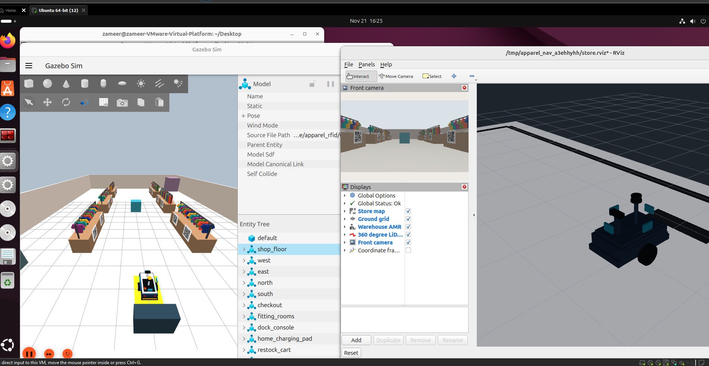
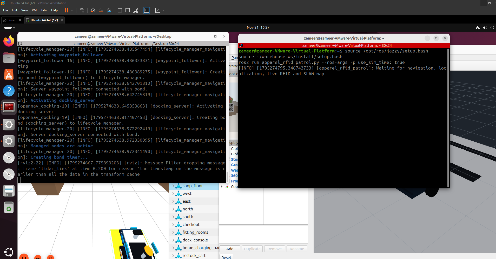

# Retail Inventory Robot — ROS 2

A robot simulation that explores how robots can check clothing-store stock automatically.

The robot is designed to leave its charging station, travel around the store, read clothing tags, save the product details, and return to the same station.

## See the Project

### Clothing Store and Robot

The left window shows the simulated store. The right window shows the robot, its map, and the view from its camera.

### Navigation Setup

This screenshot shows the navigation software running and the patrol waiting for its starting conditions.

## What Does the Robot Do?

1. Starts from its charging station at a scheduled time.
2. Moves between clothing racks.
3. Uses a laser scanner to detect obstacles along its route.
4. Reads nearby clothing tags using four simulated RFID antennas.
5. Saves information about the clothes it detects.
6. Revisits racks where tags are still missing.
7. Returns to its starting station after all expected tags are recorded.

RFID tags are small electronic labels that identify individual items. Each garment in this project has its own unique tag.

## What Is in the Store?

- 6 clothing racks.
- 72 individually tagged garments.
- T-shirts, jeans, dresses, hoodies, jackets, and skirts.
- A charging station.
- A restocking cart for testing obstacle avoidance.

## What Information Is Saved?

The robot records each garment's unique tag number, clothing type, size, colour, price, and rack.

Repeated readings of the same garment count as one item. Results are saved in a database and a CSV file that can be opened in Excel.

## Tools I Used

| Tool | What it does |
|---|---|
| ROS 2 Jazzy | Connects the robot's software components |
| Python | Runs the inventory and scheduling logic |
| Gazebo | Simulates the robot and clothing store |
| RViz | Displays the robot, map, and sensor information |
| Nav2 | Plans routes and controls navigation |
| SLAM Toolbox | Builds a map from laser measurements |
| SQLite | Stores the inventory records |

## My Work

I built and connected the robot model, clothing-store environment, simulated RFID readers, navigation setup, scheduled patrol, and inventory reporting.

## Current Progress

The robot and store are displayed in Gazebo and RViz, including the camera view and navigation setup.

Testing is continuing to confirm that the robot reads all 72 tags, handles blocked routes, and returns to the charging station.

This is a simulation project. RFID reads are calculated from distance and antenna direction. Returning to the charging pad is checked using the robot's position and whether it has stopped.

## Project Files

- `src/` — Robot, store, and inventory software.
- `scripts/` — RFID setup script.
- `images/` — Project screenshots.

## Author

Zameer Hussain Mohammed  
Master's graduate in Mechatronics and Robotics
