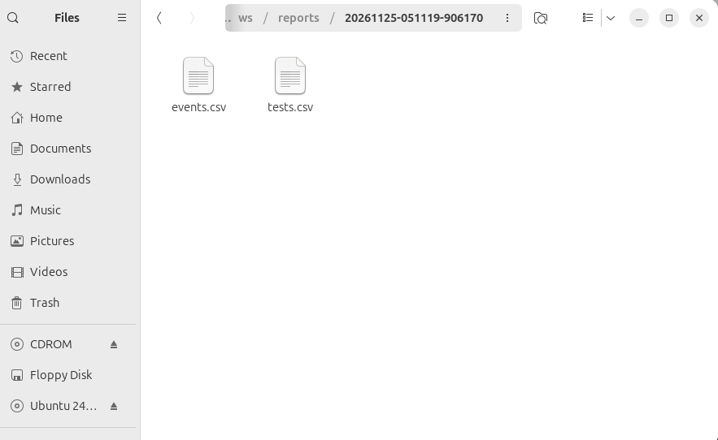
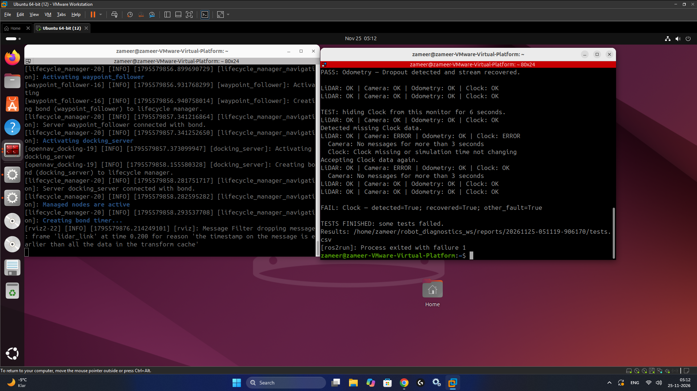

# Retail Inventory Robot with Health Monitoring

A simulated robot that is designed to check clothing-store stock and return to its charging station.

The project also includes a health monitor that checks whether the robot's sensor data is arriving and reports when something stops updating.

**Built with ROS 2 Jazzy, Python, Gazebo, and RViz.**

## See the Project

### Clothing Store and Robot

The left window shows the clothing store in Gazebo.
The right window shows the robot and its camera view in RViz.


### Navigation Setup

This screenshot shows the navigation software and the inventory patrol waiting for the required robot data.


## What Is the Robot Designed to Do?

1. Leave its charging station at a scheduled time.
2. Travel between clothing racks.
3. Detect obstacles using its laser scanner.
4. Read clothing tags using simulated RFID antennas.
5. Save the details of the clothes it finds.
6. Revisit locations where tags are missing.
7. Return to the starting station after completing the inventory.

**Complete inventory coverage, obstacle handling, and return-to-station behaviour are still being tested.**

## What Is in the Store?

- Six clothing racks.
- 72 individually tagged garments.
- T-shirts, jeans, dresses, hoodies, jackets, and skirts.
- A robot with a camera, laser scanner, and four simulated RFID antennas.
- A charging station.
- A restocking cart used as an obstacle.

## How Does Clothing Identification Work?

Each garment has a unique tag number.

For example, two identical blue shirts have different tag numbers.
This allows the inventory system to count them as two separate items.

RFID is a technology that identifies items using electronic tags.
In this project, RFID readings are simulated using distance and antenna direction.

**No physical RFID reader is used.**

## What Information Is Saved?

The inventory system records details such as:

- Unique tag number.
- Clothing type.
- Size.
- Colour.
- Price.

Reading the same tag several times does not create several garments in the inventory.

Records are stored in SQLite, a small database, and exported as CSV files that can be opened in a spreadsheet.

## Robot Health Monitoring

The health monitor works like a car dashboard:
it tells the operator when important robot data stops arriving.

| Component | What the monitor checks |
|---|---|
| LiDAR — laser scanner | Are laser-scan messages arriving? |
| Camera | Are image messages arriving? |
| Odometry — movement information | Are position and movement messages arriving? |
| Simulation clock | Is Gazebo's simulation time changing? |

If a stream stops updating for more than three real seconds, the monitor reports **ERROR**.

When updates return, it reports **OK**.

The robot can remain stationary while these checks run.

### What the Monitor Does Not Check

Receiving data does not guarantee that the measurements are correct.

This version does not check:

- Whether camera images are clear or frozen.
- Whether every clothing tag has been read.
- Whether the robot successfully avoids an obstacle.
- Whether docking is complete.

It reports problems but does not automatically repair or stop the robot.

## How the Automatic Tests Work

The program tests one data stream at a time.

For example, during the LiDAR test:

1. It checks that all four streams are working.
2. It ignores LiDAR messages inside the monitor for six seconds.
3. It checks whether missing data is detected.
4. It accepts LiDAR messages again.
5. It checks whether the status returns to OK.

The same process is repeated for the camera, odometry, and clock.

**The actual sensors remain running. Only the monitor temporarily ignores their messages.**

These tests check the monitor's fault-detection logic.
They do not prove that the robot can recover from a physical sensor failure.

## Recorded Test Result

In the recorded run, the monitor detected the deliberately hidden clock data and recognised when the clock updates returned.

However, camera messages also stopped arriving for more than three seconds during that test.

The clock test therefore reported **FAIL** because another stream failed during the test.

The camera interruption is still being investigated.



### Saved Reports

Each monitoring or test session creates a separate report folder.

| File | What it contains |
|---|---|
| `events.csv` | Changes between healthy and error states |
| `tests.csv` | Test outcomes and detection/recovery times |




## Tools Used

| Tool | Purpose |
|---|---|
| ROS 2 Jazzy | Connects the robot's software components |
| Python | Runs inventory, monitoring, and test logic |
| Gazebo | Simulates the robot and clothing store |
| RViz | Displays the robot, map, camera, and sensor data |
| Nav2 | Provides route planning and navigation |
| SLAM Toolbox | Builds a map from laser measurements |
| SQLite | Stores inventory records |
| CSV | Saves readable inventory and diagnostic reports |

## My Contribution

I assembled and configured the simulated store and robot, connected the ROS 2 components, and worked on the inventory workflow.

I added a Python health-monitoring package, ran controlled data-dropout tests, and recorded the results.

The project uses existing tools such as Nav2 and SLAM Toolbox for navigation and mapping.

## Run the Health Monitor

These instructions are for Ubuntu 24.04 with ROS 2 Jazzy installed.

### 1. Install the Dependencies

```bash
sudo apt update
sudo apt install -y \
  python3-colcon-common-extensions \
  python3-setuptools \
  ros-jazzy-rclpy \
  ros-jazzy-sensor-msgs \
  ros-jazzy-nav-msgs \
  ros-jazzy-rosgraph-msgs \
  ros-jazzy-diagnostic-msgs
```

### 2. Build the Diagnostics Package

Open a terminal in this repository's main folder and run:

```bash
source /opt/ros/jazzy/setup.bash

colcon build --symlink-install \
  --packages-select robot_health_monitor

source install/setup.bash
```

### 3. Start Your Existing Robot Simulation

Launch the retail robot using your existing simulation setup.

Make sure Gazebo is playing and that the robot publishes LiDAR, camera, odometry, and clock data.

The monitor does not launch the simulation itself.

### 4. Start Monitoring

In the terminal where you built and sourced this workspace:

```bash
ros2 run robot_health_monitor monitor
```

When all four streams are available, the terminal shows:

```text
LiDAR: OK | Camera: OK | Odometry: OK | Clock: OK
```

Press **Ctrl+C** to stop.

### 5. Run the Automatic Tests

Stop the live monitor first, but keep Gazebo running.

```bash
ros2 run robot_health_monitor monitor --test
```

Only one monitor or test process can run at a time.

### 6. Open Your Reports

The current program saves new reports here:

```bash
xdg-open ~/robot_diagnostics_ws/reports
```

The `results/` folder in this repository contains selected reports copied from completed runs.

## Current Progress

- The clothing-store environment and robot are displayed in Gazebo.
- RViz displays the robot and sensor information.
- The health monitor receives data from the running simulation.
- Controlled dropout tests have been executed and reports saved.
- Intermittent camera-data interruptions remain under investigation.
- Full inventory coverage and reliable return-to-station behaviour still require further validation.

This is a simulation project. Returning to a simulated charging station does not demonstrate physical battery charging.

## Project Files

| Folder | Contents |
|---|---|
| `src/` | Robot, store, inventory, and diagnostics packages |
| `src/robot_health_monitor/` | Health-monitoring and fault-test code |
| `scripts/` | Existing project setup scripts |
| `images/` | Project screenshots |
| `results/diagnostics/` | Selected diagnostic CSV reports |

## Author

**Zameer Hussain Mohammed**

Master's graduate in Mechatronics and Robotics
